# BÁO CÁO THỰC HÀNH BÀI 5

**Chủ đề:** Phân tích và kiểm thử bảo mật — SAST và DAST

**Ngày thực hiện:** 21/10/2026

**Họ tên / MSSV / Lớp:** ........................................................

## 1. Mục tiêu và môi trường

Xây dựng công cụ phân tích bảo mật tĩnh cho Python, xuất SARIF; xây dựng công cụ
giám sát động và cung cấp Flask API theo mục 5.2 và 5.4 của tài liệu `lab-05.pdf`.

Môi trường đã chạy: Windows, Python 3.14, Flake8 7.4.1, psutil 7.2.2,
Flask 3.1.3. Thư viện cài riêng trong `.deps/`; không thay đổi Python hệ thống.
Toàn bộ kết quả bên dưới được tạo bằng `run.ps1 All` và lưu trong `reports/`.

## LAB_1 — Phần 5.2: SAST-TOOL

### 1. Thiết kế SAST

Luồng xử lý:

```text
Tệp Python → đọc mã → ASTAnalyzer + VulnPatternMatcher
                              ↓
                       SecurityRuleEngine
                              ↓
                cộng cảnh báo CodeQualityChecker
                              ↓
                       SarifReporter → .sarif
```

`ASTAnalyzer` dùng `ast.parse` và duyệt lời gọi hàm để tìm `eval` và `exec`.
Mã được phân tích không bị thực thi. `VulnPatternMatcher` nhận diện gán mật khẩu
chuỗi cố định và import pickle qua cấu trúc AST để tránh khớp comment hay chuỗi
minh họa. Matcher cũng hỗ trợ thêm pattern regex tùy chỉnh.

`SecurityRuleEngine` tải luật JSON, gán `high` cho eval/exec, `medium` cho pattern,
`low` cho lint. Luật tùy chỉnh có thể truyền qua `--rules`. Việc đánh giá không
làm thay đổi các issue đầu vào.

`CodeQualityChecker` chạy Flake8 bằng `sys.executable -m flake8`, đọc số dòng/cột
với regex xử lý được dấu `:` trong đường dẫn Windows, chuyển cột từ 1 về 0 trước
khi đưa cho reporter. Khi thiếu thư viện, công cụ báo lỗi thay vì trả kết quả sạch.

`SarifReporter` xuất SARIF 2.1.0 bằng JSON chuẩn; ánh xạ severity thành
`error`/`warning`/`note`, chuyển cột về chuẩn 1-based, tạo URI đúng cho tệp có dấu
cách. Có kiểm thử nội dung và vị trí báo cáo; người thực hiện đã mở SARIF Viewer
và kiểm tra cảnh báo tại dòng `eval`. Chưa kiểm chứng bằng JSON Schema đầy đủ.

### 2. Kết quả SAST

| Tệp | Cảnh báo bảo mật | Cảnh báo Flake8 | Tổng |
|---|---:|---:|---:|
| `vulnerable_01.py` | 3: mật khẩu cố định, import pickle, eval | 2 | 5 |
| `vulnerable_02.py` | 2: eval, exec | 0 | 2 |
| `safe_example.py` | 0 | 0 | 0 |

Minh chứng: `reports/sast-summary.json`, ba tệp `.sarif` và các log `*-scan.txt`.
Số lượng khác ảnh minh họa của đề vì mã đã định dạng lại và phiên bản Flake8 khác.
Không cố tạo thêm cảnh báo để khớp ảnh chụp.

### 3. Hình ảnh thực hiện phần 5.2

**Hình 1. Kiểm thử SAST: 14 test đều thành công.**

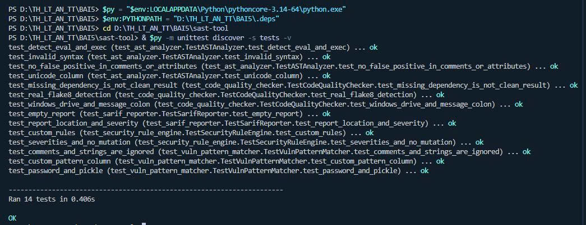

**Hình 2. Quét ba tệp Python: lần lượt 5, 2 và 0 cảnh báo.**

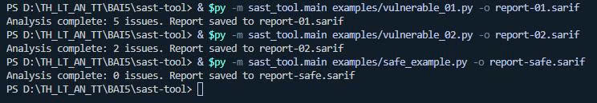

**Hình 3. SARIF Viewer hiển thị vị trí cảnh báo tại lời gọi eval.**

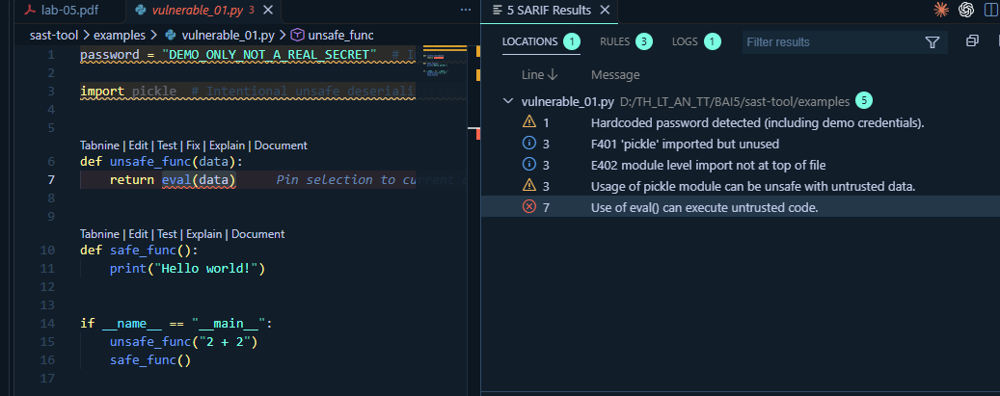

**Hình 4. Danh sách năm cảnh báo của mẫu vulnerable_01.py.**

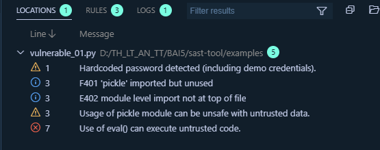

### 4. Phân tích và khắc phục

Phân tích và hướng khắc phục:

| Vấn đề | Nguy cơ | Cách xử lý |
|---|---|---|
| `eval(data)` / `exec(code)` | Thực thi mã tùy ý nếu dữ liệu đến từ nguồn không tin cậy | Bỏ thực thi chuỗi; dùng parser theo miền nghiệp vụ; `ast.literal_eval` chỉ khi cần literal |
| Mật khẩu trong mã | Lộ thông tin khi chia sẻ mã hoặc đưa lên Git | Dùng biến môi trường hoặc kho bí mật; ví dụ bài làm chỉ dùng nhãn dữ liệu giả |
| Import pickle | Cần rà soát vì giải tuần tự pickle không tin cậy có thể thực thi mã | Ưu tiên JSON; việc import đơn thuần chưa chứng minh có khai thác |
| Import thừa / vị trí import | Khó duy trì và che khuất phụ thuộc | Bỏ import không dùng, sắp xếp import đầu tệp |

SAST hiện chưa theo dõi luồng dữ liệu, alias, shadowing hay tất cả sink bảo mật.
Kết quả không có cảnh báo chỉ có nghĩa không khớp các kiểm tra đã triển khai.

## LAB_2 — Phần 5.4: DAST-TOOL

### 1. Thiết kế và kết quả DAST

| Thành phần | Thực hiện và kết quả |
|---|---|
| RuntimeMonitor | psutil giám sát PID hiện tại; lấy CPU %, RSS > 0 và danh sách tệp mở |
| MemoryAnalyzer | `gc.collect()` và `gc.garbage`; mẫu chạy trả danh sách rỗng; `2**64` nằm ngoài miền signed 64-bit |
| NetworkTrafficAnalyzer | Đọc bộ đếm bytes/packets theo từng card mạng trên máy |
| SecurityBehaviorChecker | Phân loại sự kiện audit; chương trình mẫu cố định tạo sự kiện `compile`, `exec` thật trong Python con |
| VirtualSandbox | Demo echo trả `Hello Sandbox`, stderr rỗng; kiểm thử chạy Python trong thư mục tạm, timeout, mã thoát và dọn thư mục |

Minh chứng: `reports/dast-demo.json`. Giá trị CPU/RSS/bộ đếm mạng thay đổi theo
thời điểm; không dùng chúng làm giá trị kỳ vọng cố định trong kiểm thử.

Điều chỉnh so với đoạn mã minh họa trong đề:

- Không tìm tên `eval` trong chính tệp checker: cách đó sẽ khớp danh sách từ khóa
  của công cụ. Bổ sung quan sát audit thực tế của một chương trình mẫu tin cậy.
- Kiểm tra đủ biên signed 64-bit: `-2**63` hợp lệ, `2**63 - 1` hợp lệ,
  `2**63` và `-2**63 - 1` không hợp lệ. Python int không tự overflow ở 64 bit.
- Chạy tiến trình với danh sách đối số và `shell=False`; có timeout và dọn thư mục.
- Không gọi thư mục làm việc tạm là cách ly hệ điều hành. Backend Docker tùy chọn
  bổ sung giới hạn tài nguyên, mạng và quyền, nhưng chưa được chạy kiểm chứng trong phiên này.

Giới hạn: GC không phát hiện mọi rò rỉ bộ nhớ hoặc lỗi bộ nhớ native; chỉ số mạng
không phải phân tích nội dung gói tin. Sự kiện audit đáng xem xét chưa phải kết luận
có mã độc. Công cụ không giám sát toàn bộ chương trình hay syscall trên máy.

### 2. Kiểm tra Flask API

Đủ năm endpoint được gọi qua Flask test client. Sau đó người thực hiện đã
khởi động Flask tại `http://127.0.0.1:5000` và gọi trực tiếp cả năm API bằng
`Invoke-RestMethod` trong PowerShell; các kết quả đã được chụp và gửi trong chat.

| Request | HTTP | Kết quả chính |
|---|---:|---|
| `GET /api/monitor` | 200 | `cpu_usage`, `memory_usage`, `open_files` |
| `GET /api/memory` | 200 | `memory_leaks`, `overflow_test: true` |
| `GET /api/network` | 200 | `network_stats` theo interface |
| `GET /api/security` | 200 | `runtime_events` có `compile`, `exec`; `exec` được đánh dấu cần xem xét |
| `POST /api/sandbox` với echo | 200 | `stdout: "Hello Sandbox\n"`, stderr rỗng, returncode 0 |

Kiểm thử bổ sung: JSON sai/thiếu trường trả 400; lệnh khác echo trả 403.
Ứng dụng bind `127.0.0.1:5000`, không mở API thực thi lệnh tùy ý ra mạng.
Minh chứng đầy đủ: `reports/api-results.json`.

### 3. Hình ảnh thực hiện phần 5.4

**Hình 5. Kiểm thử DAST và API: 16 test đều thành công.**

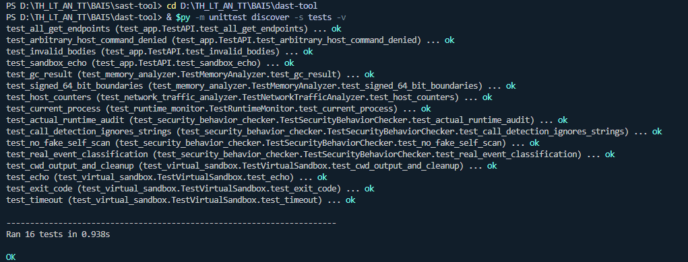

**Hình 6. Chạy main.py: giám sát tiến trình và kiểm tra bộ nhớ.**

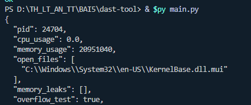

**Hình 7. Sự kiện audit và kết quả demo sandbox.**

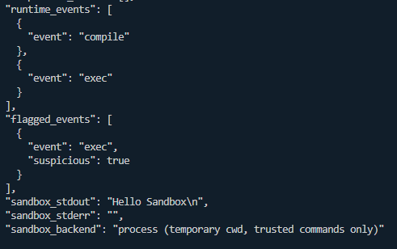

**Hình 8. Khởi động Flask tại http://127.0.0.1:5000.**

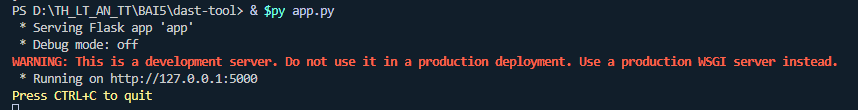

**Hình 9. Gọi API giám sát tiến trình qua PowerShell.**

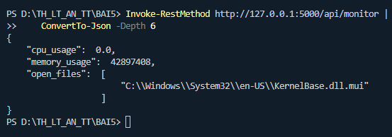

**Hình 10. Gọi API kiểm tra bộ nhớ.**

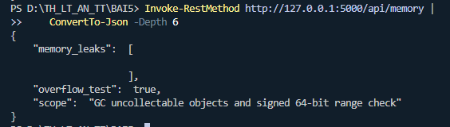

**Hình 11. Gọi API thống kê mạng.**

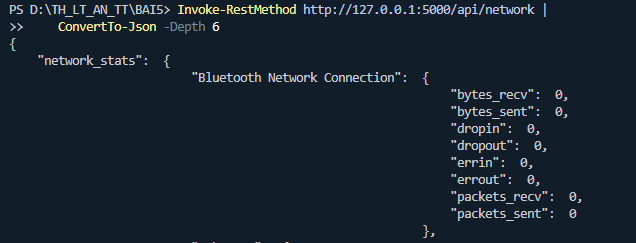

**Hình 12. Gọi API kiểm tra sự kiện bảo mật.**

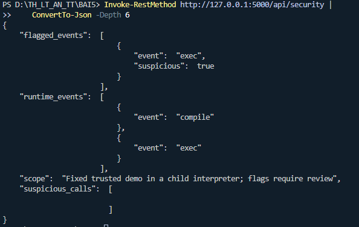

**Hình 13. Gọi API sandbox: Hello Sandbox và mã thoát 0.**

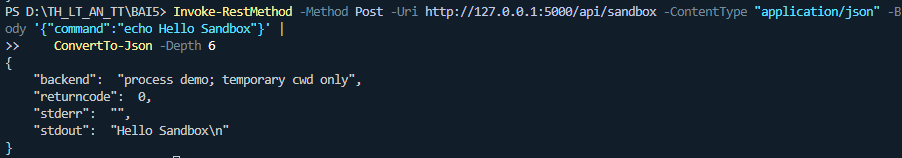

## 6. Kiểm thử và tái hiện

| Bộ kiểm thử | Số test | Kết quả |
|---|---:|---|
| SAST | 14 | PASS |
| DAST và Flask API | 16 | PASS |
| Tổng | 30 | PASS |

Các tình huống quan trọng gồm phát hiện eval/exec, comment không bị khớp nhầm,
cột Unicode, đường dẫn Windows, luật tùy chỉnh, SARIF rỗng/vị trí/severity,
Flake8 thật, biên số 64-bit, số liệu tiến trình thật, audit thật,
timeout, cleanup, mã thoát và validation request.

Ch?y l?i ki?m th? t? th? m?c BAI_5:

```powershell
cd LAB_1/sast-tool
python -m unittest discover -s tests -v
cd ../../LAB_2/dast-tool
python -m unittest discover -s tests -v
```

H??ng d?n c?i ??t, ch?y ch??ng tr?nh v? g?i API n?m trong README c?a t?ng lab.
