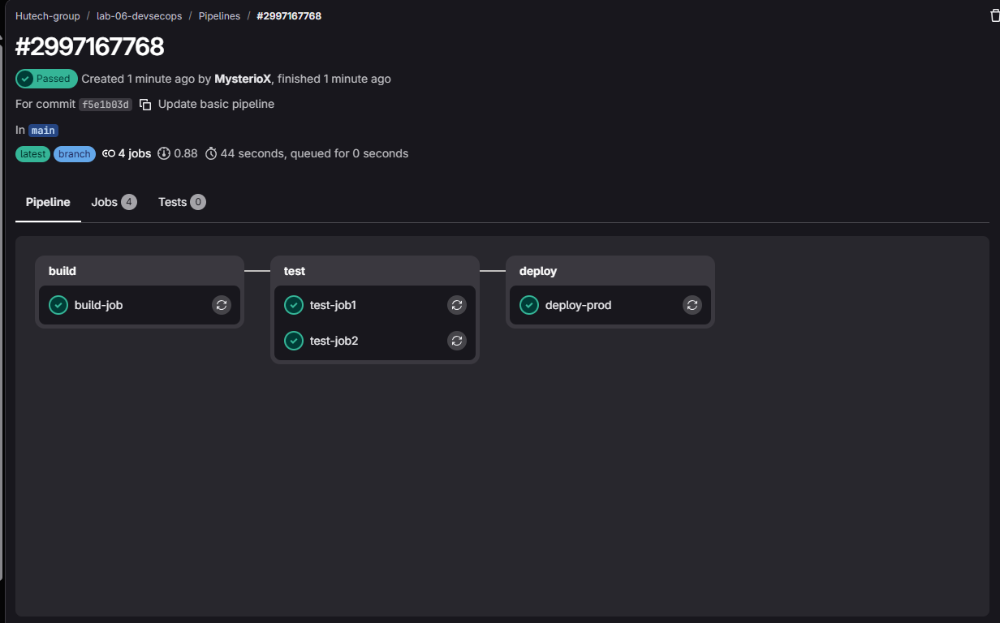
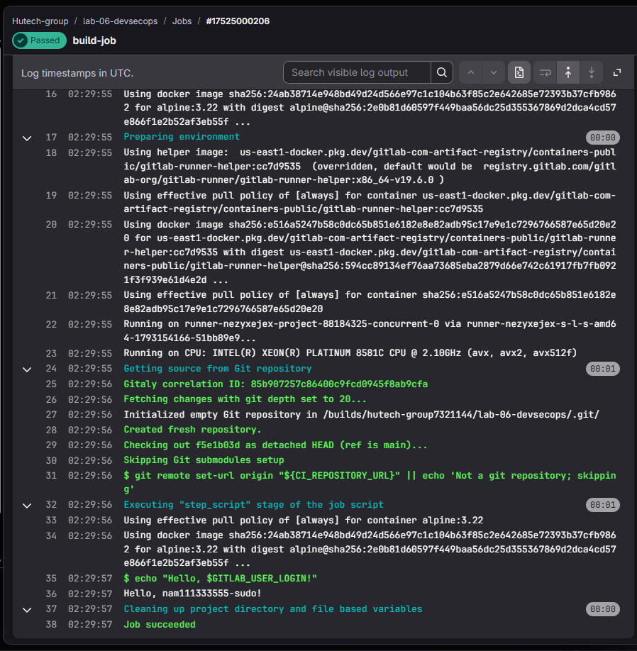
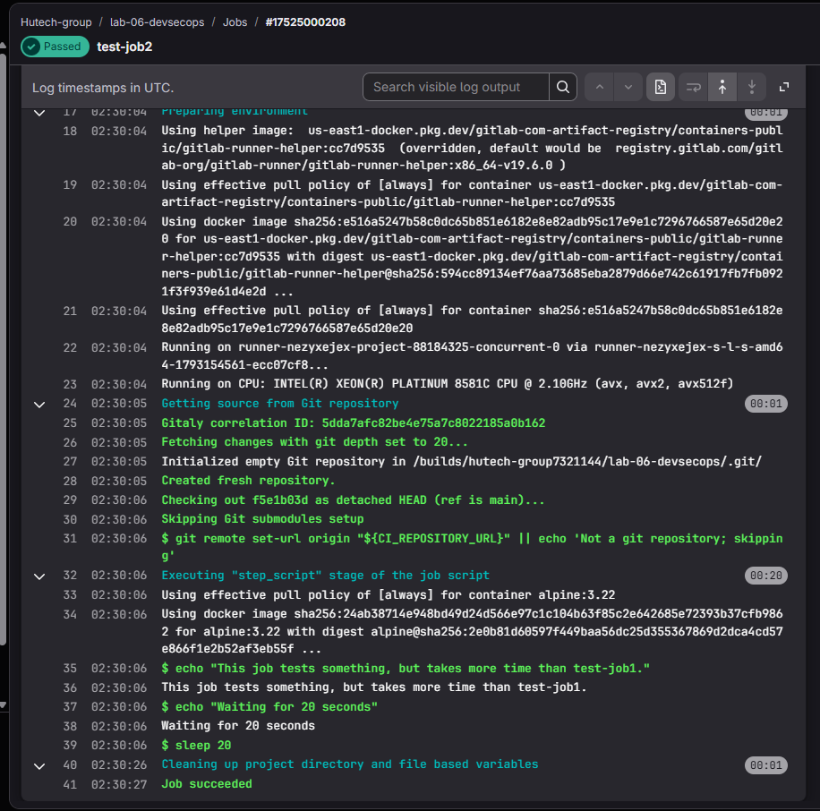
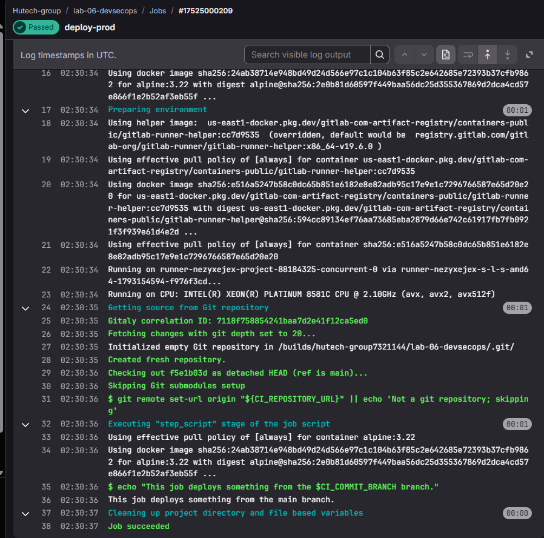

# LAB 1 - Tạo và chạy CI/CD pipeline (6.2.1 Thực hành)

Pipeline GitLab cơ bản minh họa thứ tự thực hiện các stage, job cùng stage,
biến môi trường và log thực thi trên runner.

## Cấu trúc

```text
LAB_1/
├── .gitlab-ci.yml           # Pipeline cơ bản: ba stage, bốn job
├── image/                  # Ảnh minh chứng thực hiện Lab 1
└── README.md
```

## Cài đặt và chạy

1. Tạo dự án GitLab và kiểm tra runner hỗ trợ container image.
2. Đưa tệp `.gitlab-ci.yml` của Lab 1 vào gốc dự án GitLab rồi commit.
3. Mở **Build → Pipelines**, chọn pipeline vừa chạy để xem sơ đồ.
4. Mở từng job để xem log và trạng thái kết thúc.

## Chức năng

- `build-job`: in lời chào bằng biến `GITLAB_USER_LOGIN`.
- `test-job1`: in thông báo kiểm thử.
- `test-job2`: in thông báo và thực hiện `sleep 20`.
- `deploy-prod`: in nhánh từ `CI_COMMIT_BRANCH`, khai báo environment `production`.

Thứ tự stage là `build → test → deploy`. Hai job test có thể chạy song song
khi runner có đủ khả năng xử lý; deploy đợi cả hai job test thành công.

## Kết quả

[Pipeline #2997167768](https://gitlab.com/hutech-group7321144/lab-06-devsecops/-/pipelines/2997167768)
đạt **Passed**, đủ bốn job thành công, tổng thời gian hiển thị là 44 giây.

**Hình 1. Pipeline cơ bản: ba stage và bốn job thành công.**



**Hình 2. Build job in lời chào người dùng và kết thúc thành công.**



**Hình 3. Test job 2 thực hiện lệnh sleep 20 và kết thúc thành công.**



**Hình 4. Deploy job in thông báo nhánh main và kết thúc thành công.**



## Giới hạn

`deploy-prod` chỉ mô phỏng triển khai bằng `echo`. Website thật được build
và phát hành trong Lab 2.
