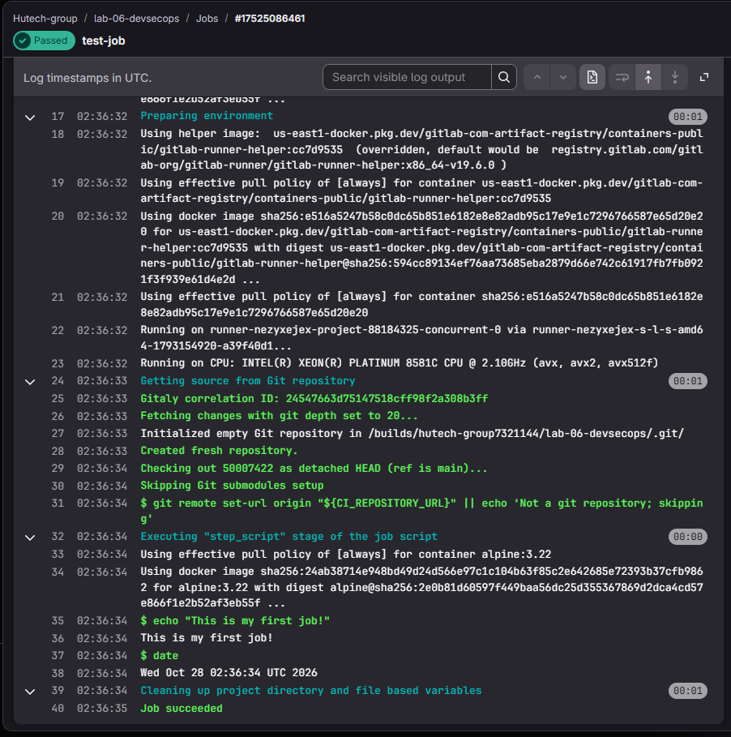
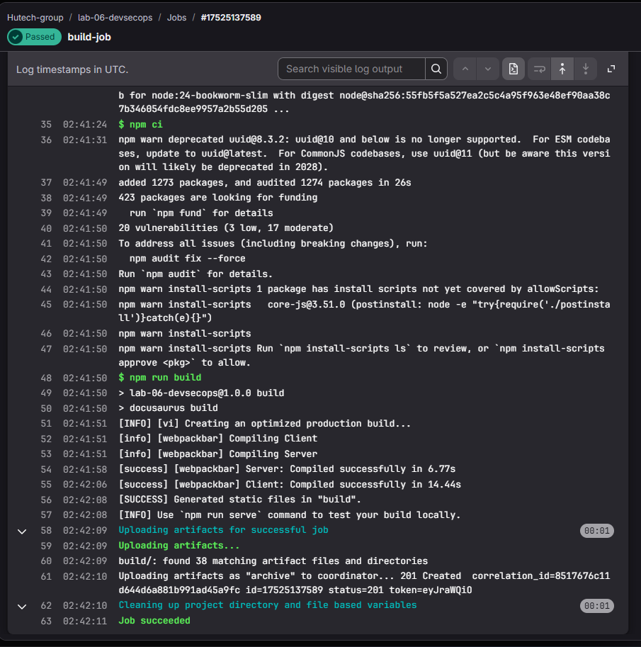
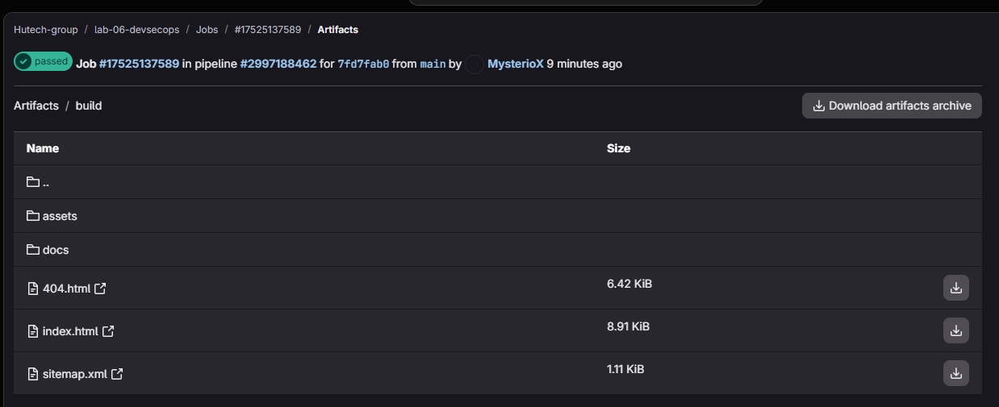
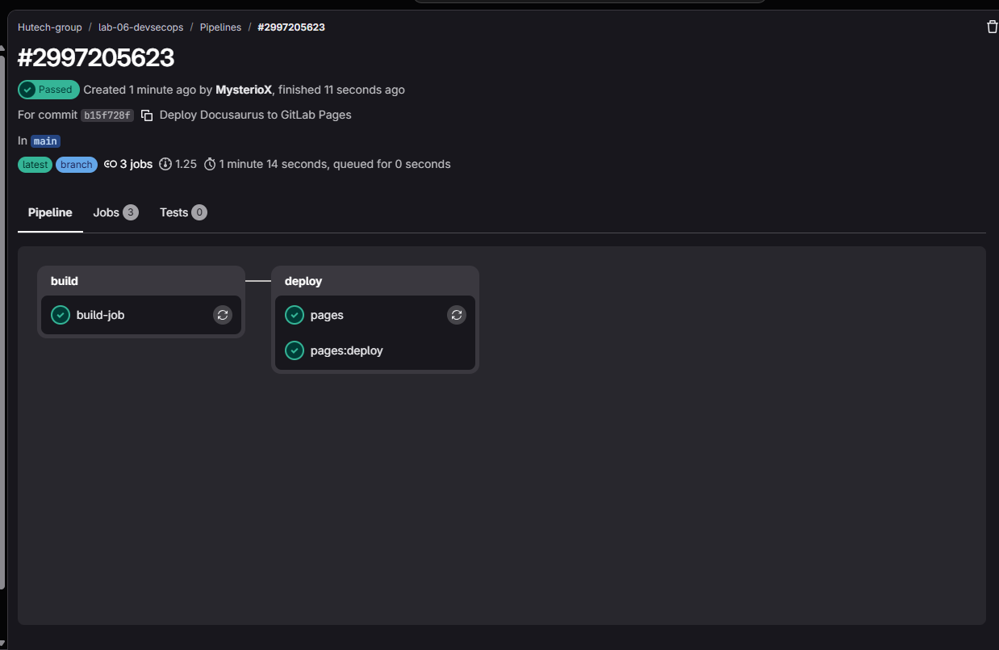
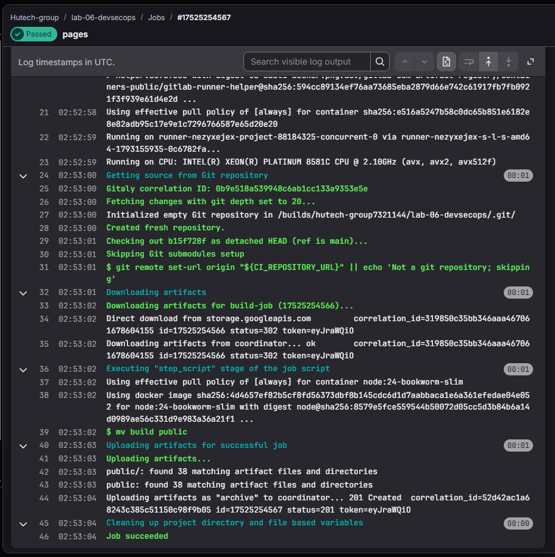
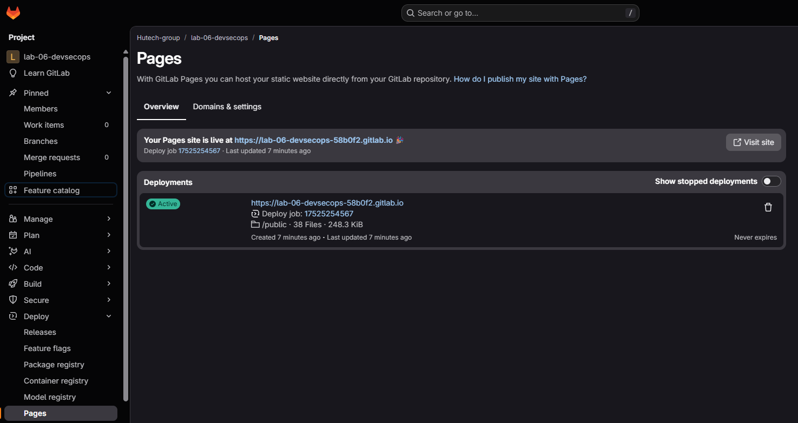

# LAB 2 - Docusaurus và GitLab Pages (6.2.2 Thực hành)

Website Docusaurus được build trên GitLab runner, lưu kết quả dưới dạng artifact
và triển khai bằng GitLab Pages.

## Cấu trúc

```text
LAB_2/
├── image/                         # Ảnh minh chứng thực hiện Lab 2
├── pipeline-tutorial/
│   ├── .gitlab-ci.yml              # Hai stage build/deploy
│   ├── ci/                        # Cấu hình từng bước và các bản mở rộng
│   ├── docs/                      # Nội dung tài liệu
│   ├── src/                       # Trang chủ và CSS
│   ├── scripts/                   # Tính URL và baseUrl triển khai
│   ├── tests/                     # Năm kiểm thử URL triển khai
│   ├── docusaurus.config.js
│   ├── package.json
│   └── package-lock.json
└── README.md
```

## Cài đặt và chạy

Yêu cầu Node.js 22 trở lên và npm. Trong PowerShell:

```powershell
cd pipeline-tutorial
npm.cmd ci
npm.cmd test
npm.cmd run build
npm.cmd run serve
```

Mở địa chỉ localhost được in trong terminal để xem bản build tại máy.

Để chạy trên GitLab, đưa **nội dung bên trong `pipeline-tutorial/` vào gốc
repository GitLab**, bao gồm các tệp ẩn `.gitlab-ci.yml` và `.gitignore`.
Commit thay đổi rồi vào **Build → Pipelines**.

## Chức năng

- `build-job`: dùng image `node:24-bookworm-slim`, chạy `npm ci`, `npm run build`,
  lưu artifact `build/`.
- `pages`: tải artifact của build-job, chạy `mv build public`, phát hành thư mục
  `public/` bằng `pages.publish`.
- `pages:deploy`: job GitLab tạo để triển khai Pages.
- Cấu hình Docusaurus tách `CI_PAGES_URL` thành `url` và `baseUrl`, hỗ trợ unique
  domain và URL có đường dẫn dự án. Biến `PAGES_URL` dùng khi cần ghi đè.

Pipeline minh chứng có hai stage `build → deploy`. Chỉ nhánh mặc định được
triển khai Pages. Kiểm thử URL được chạy tại máy; bản ba stage có thêm test
được lưu riêng ở `ci/06-build-test-deploy.gitlab-ci.yml`.

## Kết quả

| Bước | Kết quả thực tế |
|---|---|
| Job đầu tiên | In thông báo và ngày giờ, Job succeeded |
| Build website | Generated static files in build; lưu 38 tệp/thư mục khớp artifact |
| Pipeline triển khai | Build và deploy thành công; ba job đều xanh |
| GitLab Pages | Trạng thái Active, website hiển thị trên unique domain |
| Kiểm thử tại máy | 5/5 test URL thành công |

- [Pipeline build #2997188462](https://gitlab.com/hutech-group7321144/lab-06-devsecops/-/pipelines/2997188462)
- [Pipeline triển khai #2997205623](https://gitlab.com/hutech-group7321144/lab-06-devsecops/-/pipelines/2997205623)
- [Website Docusaurus](https://lab-06-devsecops-58b0f2.gitlab.io/)

**Hình 5. Job đầu tiên in thông báo và kết quả lệnh date.**



**Hình 6. Docusaurus build thành công và upload artifact.**



**Hình 7. Artifact chứa assets, docs và index.html.**



**Hình 8. Pipeline hai stage build/deploy: build-job, pages và pages:deploy đều thành công.**



**Hình 9. Job Pages tải artifact, chuyển build thành public và upload thành công.**



**Hình 10. GitLab Pages hiển thị URL website và deployment Active.**



**Hình 11. Trang chủ Docusaurus truy cập được trên GitLab Pages.**


## Bảo mật và giới hạn

Log cài đặt dependency ghi nhận **20 package bị ảnh hưởng: 3 LOW và 17 MODERATE**.
Audit cục bộ sau cập nhật `tinypool@2.1.2` và `serialize-javascript@7.1.3`
không còn HIGH/CRITICAL tại thời điểm kiểm tra. Cần tiếp tục theo dõi các cảnh báo
còn lại; không kết luận website không có lỗ hổng chỉ dựa vào build thành công.

Các cấu hình quét dependency, secret và misconfiguration là bản mở rộng,
chưa có ảnh chạy Trivy trên GitLab. MFA, bảo vệ nhánh, vault, ký commit,
SAST và DAST cần cấu hình riêng theo môi trường sử dụng.
