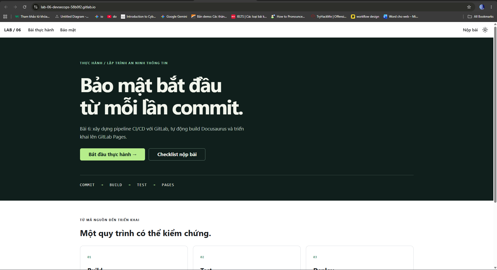

# BÀI 6 - Bảo mật với DevSecOps

| Lab | Nội dung | Mã nguồn | Ảnh minh chứng |
|---|---|---|---|
| [LAB_1](LAB_1/README.md) | 6.2.1 Tạo và chạy CI/CD pipeline | `LAB_1/.gitlab-ci.yml` | `LAB_1/image/` (4 ảnh) |
| [LAB_2](LAB_2/README.md) | 6.2.2 Docusaurus và GitLab Pages | `LAB_2/pipeline-tutorial/` | `LAB_2/image/` (7 ảnh) |

Pipeline cơ bản gồm ba stage và bốn job đã **Passed**. Pipeline Docusaurus đã build,
lưu artifact và triển khai GitLab Pages thành công; `build-job`, `pages`,
`pages:deploy` đều thành công.

- [Dự án thực hành GitLab](https://gitlab.com/hutech-group7321144/lab-06-devsecops)
- [Website Docusaurus](https://lab-06-devsecops-58b0f2.gitlab.io/)
- [Báo cáo thực hành](BAO_CAO.md)

Chi tiết quá trình thực hiện và **11 ảnh minh chứng** được trình bày trong
README từng lab và báo cáo.

## Kết quả triển khai

